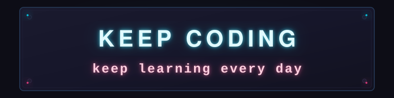

<!-- ===== NEON SIGN ===== -->

 

<!-- ===== TYPING SVG ===== -->

 

---

### 🧰 Languages & Tools

  <!-- Customize these badges with your own tools! -->
  
  
  
  

---

### 📊 GitHub Stats

  
  

  

---

  ✨ Powered by late nights &amp; neon dreams

